<p align="center">
  
</p>

<marquee behavior="scroll" direction="left" scrollamount="3" style="opacity:0.75">
  <code>rent-canvas</code>&nbsp;·&nbsp;<code>wage-brush-economics</code>&nbsp;·&nbsp;<code>gentrification-painter</code>&nbsp;·&nbsp;<code>auction-fever-simulator</code>&nbsp;·&nbsp;<code>color-stock-market</code>&nbsp;·&nbsp;<code>inflation-easel</code>&nbsp;·&nbsp;<code>starving-artist-simulator</code>&nbsp;·&nbsp;<code>pixel-gallery-market</code>&nbsp;·&nbsp;<code>art-money-flow</code>&nbsp;·&nbsp;<code>museum-vs-street</code>&nbsp;·&nbsp;<code>optiflow</code>&nbsp;·&nbsp;<code>financial-modeling-toolkit</code>&nbsp;·&nbsp;<code>modern-portfolio-theory-mpt-optimizer</code>&nbsp;·&nbsp;<code>black-scholes-and-monte-carlo-option-pricer</code> &nbsp;·&nbsp;
</marquee>

<p align="center">
  <sub>Economics student in Austin, TX.</sub><br/>
  <sub>I build things at the intersection of markets, technology, and art —</sub><br/>
  <sub>then paint them so the theory is easier to swallow.</sub>
</p>

---

### the index

| | | |
|:--|:--|:--|
| `rent-canvas` | What your rent buys, drawn to scale. | 🖼️ |
| `wage-brush-economics` | Your brush size = your wage. Paint inequality. | 🖌️ |
| `gentrification-painter` | A neighborhood that prices out its artists, one cell at a time. | 🧱 |
| `color-stock-market` | Red, blue, yellow as living stocks. Your portfolio *is* the painting. | 📈 |
| `auction-fever-simulator` | Ten artworks, five bots, and one very distorted price. | 🔨 |
| `financial-modeling-toolkit` | Three-statement models, DCF, WACC. The unfun one. | 📊 |

<p align="center">
  <sub>full catalogue → <a href="https://github.com/maanas-pab?tab=repositories">14 repos &amp; counting</a></sub>
</p>

---

### currently

```
$ cat now.txt
reading markets, drawing conclusions.
learning that a good chart beats a good argument.
```

<p align="center">
  <a href="https://github.com/maanas-pab">github</a> ·
  <a href="mailto:318053188+maanas-pab@users.noreply.github.com">email</a>
</p>

<p align="center">
  <sub>built at 2am, like most good economics.</sub>
</p>
