<p align="center">
  
</p>

<p align="center">
  
</p>

<p align="center">
  <sub>Economics student @ UT Austin.</sub><br/>
  <sub>I build things at the intersection of markets, technology, and art —</sub><br/>
  <sub>then paint them so the theory is easier to swallow.</sub>
</p>

---

### the index

| | | |
|:--|:--|:--|
| `rent-canvas` | What your rent buys, drawn to scale. | 🖼️ |
| `wage-brush-economics` | Your brush size = your wage. Paint inequality. | 🖌️ |
| `gentrification-painter` | A neighborhood that prices out its artists, one cell at a time. | 🧱 |
| `color-stock-market` | Red, blue, yellow as living stocks. Your portfolio *is* the painting. | 📈 |
| `auction-fever-simulator` | Ten artworks, five bots, and one very distorted price. | 🔨 |
| `financial-modeling-toolkit` | Three-statement models, DCF, WACC. The unfun one. | 📊 |

<p align="center">
  <sub>full catalogue → <a href="https://github.com/maanas-pab?tab=repositories">14 repos &amp; counting</a></sub>
</p>

---

### currently

```
$ cat now.txt
reading markets, drawing conclusions.
learning that a good chart beats a good argument.
```

<p align="center">
  <a href="https://github.com/maanas-pab">github</a> ·
  <a href="mailto:maanas.pabbathi@utexas.edu">email</a> ·
  <a href="https://www.linkedin.com/in/maanas-pabbathi/">linkedin</a>
</p>

<p align="center">
  <sub>built at 2am, like most good economics.</sub>
</p>
